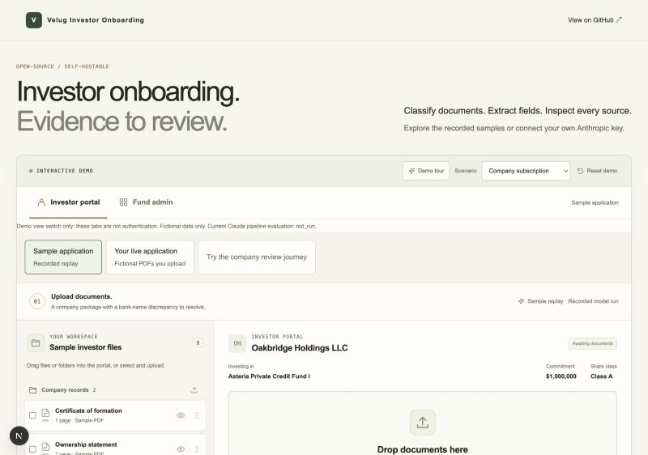
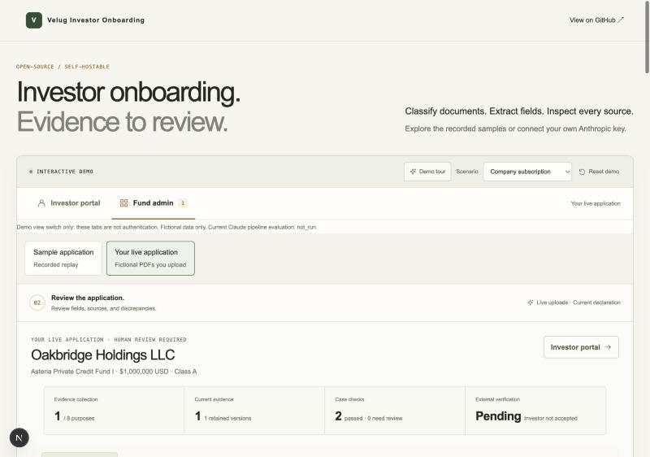
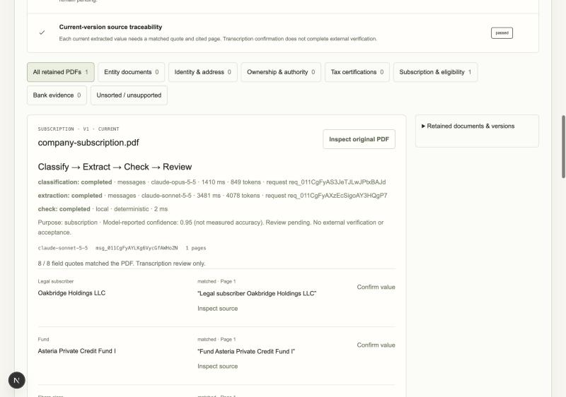
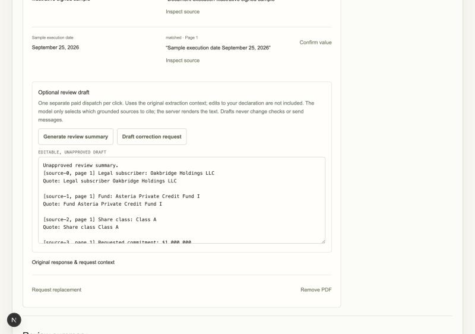

# Velug Investor Onboarding Portal

A self-hostable, open-source **fictional-data demo/starter** for document intake and evidence review. **Live demo:** [velug.ai/investor-onboarding-example](https://velug.ai/investor-onboarding-example) runs this same pipeline. Investor/admin demo tabs, sample folder drag/drop, original PDF/page/quote inspection, editable declarations, correction requests, explicit v2 replacement history, optional tutorial, backend diagrams and scoped evaluation evidence are included.

**Try samples without keys.** Node 24.19.0:

```bash
git clone https://github.com/pranavred/velug-investor-onboarding-portal.git
cd velug-investor-onboarding-portal
npm ci --ignore-scripts
npm run dev
```

Open http://localhost:3000. Select Sample application, upload the fictional folder, switch to Fund admin and inspect a source. Request a bank correction, upload the requested v2 and compare history. Refresh or Reset demo clears the browser-memory workspace. Tutorial dismissal alone persists locally.

[](https://vercel.com/new/clone?repository-url=https%3A%2F%2Fgithub.com%2Fpranavred%2Fvelug-investor-onboarding-portal)

## What it looks like

| Investor portal | Fund admin review |
|---|---|
|  |  |

| Live processing trace | Optional review draft |
|---|---|
|  |  |

## Optional live AI

Bring your own **server-only** Anthropic API key, shared Redis and fresh session-signing secret. Follow [local/runtime setup](docs/deployment.md). Builds, tests and CI make **zero provider calls**.

1. Claude Opus 5.5 (`claude-opus-5-5`) classifies bounded page-labelled text into one purpose with a model-reported confidence. It never receives PDF bytes.
2. A supported PDF normally uses a second dispatch to Claude Sonnet 5.5 (`claude-sonnet-5-5`), which receives the original PDF and returns purpose-specific fields with page numbers and verbatim quotes under a JSON-schema structured output.
3. Deterministic checks validate schema/purpose, page quotes and declared case comparisons. Missing, unmatched or contradictory evidence remains for review. Classification alone cannot replace v1.
4. Optional explicit summary/correction drafts use a separate Claude Opus 5.5 dispatch, are disabled by default and render source-grounded facts selected by the model. They never send messages or change checks.

Model ids are configurable; any `claude-*` id is accepted and nothing is substituted automatically. A refusal, truncated output, unavailable model or exhausted account leaves sample replay usable and the live document in manual review. The actual endpoint, model, timings, token usage and request IDs appear in the Fund admin stage trace. The provider endpoint is pinned to `api.anthropic.com`; no ambient base URL or proxy setting is honoured.

**Current model evaluation: `measured_current`.** Run of October 21, 2026: 17 held-out fictional text PDFs through the actual pipeline in 33 dispatches. Purpose and folder 17/17, expected-value recall 58/58, output precision 58/58, source correctness 57/57 (right page, complete verbatim quote), case outcomes 11/11, exception detection 8/8, false clears 0/8. Model-reported classification confidence ranged 0.72 to 0.95; per document, classification took 1.4 to 5.4 s and extraction 1.9 to 3.3 s, 75,816 tokens in total. Every retained output is in the in-app panel and `evaluations/current/report.json`; the status turns `stale` automatically when pipeline source changes. The 31-call/17-call GPT-4.1 records are historical reference measurements of the earlier pipeline only. Quote matches are source checks, not accuracy, authenticity or external verification. [Evaluation methods, the private paid runner and the publish step](docs/evaluations.md).

## Boundaries

- Fictional documents only. Role tabs are a demo switch, **not authentication**.
- No investor acceptance, identity authenticity, sanctions/PEP/AML, tax approval or bank-control verification.
- Browser-memory data, no durable document store or audit database. Exports are review snapshots.
- Anthropic receives classification text and extraction PDFs under its API data-handling terms; review your own agreement and retention settings. No data/API proxy goes through Velug.
- Default shared budget: 20 global / 5 anonymous-session reservations per Redis-clock hour. Normally two per supported PDF. Redis failure denies dispatch. Four local parser slots and 12 retained browser PDFs are separate controls. Limits: 2 MiB, 10 pages, 60,000 parsed characters; text PDFs only, no OCR.

## Verify and deploy

```bash
npm test
npm run lint
npm run typecheck
npm run verify:reference
npm run verify:distribution
npm run verify:licenses
npm audit --audit-level=moderate
docker compose up --build
```

The optional manual-only GitHub workflow uses no provider secrets and is configured for disposable Redis integration and container smoke. It is not automatically triggered; GitHub Actions minutes are unavailable for this build. If TEST_REDIS_URL is absent, that integration check is reported as skipped. Docker/Compose and Vercel import use your own infrastructure; no hosted live deployment is required. [Release verification](docs/releases/v0.1-verification.md) states actual evidence and limitations.

See [architecture](docs/architecture.md), [deployment](docs/deployment.md), [production prerequisites](docs/production-readiness.md), [security](SECURITY.md), [contributing](CONTRIBUTING.md), [Apache-2.0](LICENSE) and [dependency notices](THIRD_PARTY_NOTICES.md). Code and fictional fixtures are independently extracted; the existing Velug business website and its history are not included.
