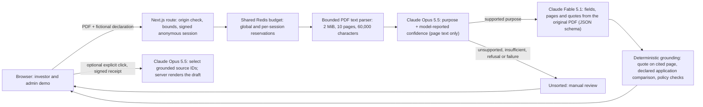

# Architecture

One server-only `ANTHROPIC_API_KEY` authenticates every call through the official Anthropic SDK with retries disabled, a 50-second shared deadline and the endpoint pinned to `api.anthropic.com`. Models default to `claude-opus-5-5` for classification and drafts and `claude-fable-5-1` for extraction; any `claude-*` id can be configured and none is substituted automatically. Provider error bodies are never surfaced; only the HTTP status and error type reach the trace. Sample replay remains the historical GPT-4.1 run and makes no calls.

Every processed document carries a stage trace (classify, extract, check, review) with endpoint, model, latency, token usage and request id. Case decisions are deterministic code over grounded fields; confirmations are transcription review only. Browser memory holds documents and results; Redis holds only quota counters. See [deployment](deployment.md), [evaluations](evaluations.md) and [production prerequisites](production-readiness.md).
