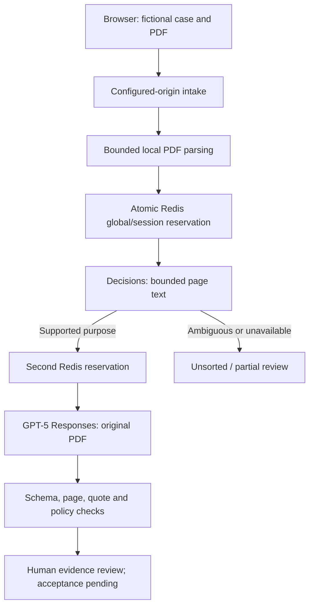

# Architecture

The classifier determines purpose/folder. Extraction never silently changes it. Failed stage two returns partial classification provenance, without fields or completion. Only successful, source-grounded, same-purpose explicitly linked v2 with essential fields supersedes v1. Reset/cancellation discard late browser results. Retries currently restart both stages and spend their dispatches; there is no hidden classification cache. No service, proxy, data callback or quota store depends on Velug.

Budgets share a single Lua operation with Redis server time and common namespace/hash tag. Reservations are durable for the hour; provider errors do not refund. Parser concurrency is a separate process-local four-slot admission control. Browser retains at most 12 PDFs, each <=2 MiB/10 pages; classifier text is <=60,000 characters, labelled by page and never silently truncated. Live PDF processing has a shared 50-second provider deadline; optional drafting has a separate 30-second deadline. Node handlers expose safe stage metadata, never raw provider headers, credentials or internal reasoning.

One server-only OPENAI_API_KEY authenticates Decisions and Responses. Models remain gpt-6-luna and requested gpt-5-2025-08-07; GPT-5 availability is unverified/deprecated. Sample replay remains the historical GPT-4.1 data. No Jev implementation is included.
