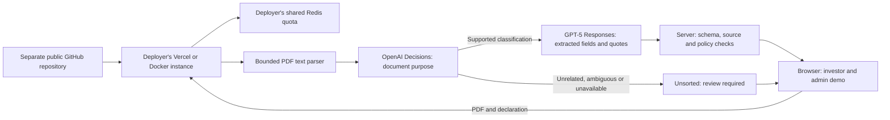

# Standalone open-source investor onboarding

Date: October 15, 2026. Status: proposed design for the requested plan. Updated to the user's OpenAI-only architecture; this document does not itself publish or deploy software.

## Intent and boundaries

Publish a standalone, self-hostable onboarding demo/starter that anyone can obtain from GitHub and deploy using their own infrastructure and provider credentials. Keep investor/admin tabs, sample folders, live PDF extraction, source inspection, correction/version history, review exports, tutorial, backend diagrams, guardrails and evaluations.

**Explicit requirement:** the open-source code must live in a different repository from the private Velug website code. Never make the website repository public. Never publish its Git history, a fork containing that history, or a branch of that repository as the product.

**User scope correction:** the new Decisions API / GPT-5 architecture applies only to the standalone open-source version. Leave the existing Velug web demo, its GPT-4.1 pipeline, reports and deployment unchanged. No website rollout is part of this plan.

Repository: `pranavred/velug-investor-onboarding-portal`. The user authorized a separate open-source GitHub release with Velug in its name; Apache-2.0 follows the approved plan. Use a fresh local directory and a fresh Git root; the approved source is the onboarding-only allowlist from website commit `c8a7b32b80291a2af2e9773f13098c89913bb3f4`, currently available in the isolated improvements checkout. Verify that source before extraction. Do not use the older website checkout with unfinished voice work as the source.

## Recommended release

Release v0.1 as a functional demo/starter with ephemeral browser state and fictional documents. It must be useful without API credentials: sample replay works immediately. Live AI is explicitly enabled by the deployer and uses their OpenAI account. Use OpenAI Decisions for document classification, then GPT-5 through Responses for field extraction with page quotes and optional evidence-based review summaries/correction drafts. Remove Jev from the release scope; one server-side OpenAI key authenticates both API paths.

Do not silently expand this into a real investor system. Authentication, investor/admin authorization, tenant isolation, durable private document storage, malware scanning, screening, approval authority, retention/deletion workflows and operational integrations are a separately specified production phase. The two role tabs are a demonstration switch, not an access-control boundary. The app must say this directly.

Alternatives considered: publishing the whole website is rejected because it exposes unrelated code/content/history; building a production multi-tenant platform first is deferred because it changes scope materially. Extracting a small, working starter is the recommended path.

## What the inspection established

- The known deployed source is Next.js 16.3.8, React 19.2.6 and TypeScript, with `unpdf`, `@vercel/firewall` and a committed npm lockfile. This is an inspected baseline, not a dependency security audit or a claim that these remain the preferred versions.
- `app/api/investor-onboarding/process/route.ts` injects the provider key from environment variables, but also hardcodes `velug.ai`, a Vercel rule identifier and a regional hosting assumption. Its non-Vercel counter is process-local. A fork cannot rely on Velug's WAF configuration.
- `scripts/evaluate-onboarding-live-ai.mjs` loads an absolute personal `.env.local` path. `.gitignore` currently ignores every `.env*`, including a future `.env.example` unless explicitly exempted.
- Root layout, metadata, navigation, CTA, downloads, local-storage keys and some fixture-generator text are Velug-specific. The root layout fetches Google fonts during the build. Shared CSS must be extracted deliberately rather than copying the entire marketing site.
- The inspected onboarding source has no Jev client or Jev API call. Jev appeared in the supplied research, not in the deployed pipeline. Do not advertise an existing Jev guardrail or invent results for one.
- The live evaluation hashes source files, including its runner. Extraction/configuration changes will invalidate correspondence with the October 3 run. Preserve its records; do not edit hashes to make the old score look current.
- This planning review did not perform a complete secret/history scan, dependency/license audit, fresh deployment or new provider evaluation. Those are implementation release gates.

## Product architecture

No request, callback, telemetry, file, key, quota dependency or payment goes through Velug infrastructure. A small optional upstream attribution link is acceptable; no compulsory sales CTA. Open source applies to the application code; OpenAI is an external proprietary service billed separately.

Use one Next.js repository, not a monorepo or published component package. Preserve the current domain modules and tests initially. Separate public presentation settings, private environment validation, classification, extraction, optional review drafting and quota infrastructure. Keep deterministic case decisions in code.

## Configuration and deployment contract

Server-only keys: `OPENAI_API_KEY`, `REDIS_URL`, `APP_SESSION_SECRET`. No `NEXT_PUBLIC_` secrets, browser key entry or credentials in Docker build arguments. No Jev credentials are required or requested.

Non-secret settings: `APP_URL`, `APP_NAME`, `LIVE_AI_ENABLED`, `OPENAI_CLASSIFICATION_MODEL`, `OPENAI_EXTRACTION_MODEL`, `OPENAI_REVIEW_MODEL`, `REVIEW_DRAFTS_ENABLED`, `QUOTA_NAMESPACE`, `GLOBAL_CALLS_PER_HOUR`, `SESSION_CALLS_PER_HOUR`. Declare public presentation values separately and expose only a validated public projection. Do not serialize the full server configuration.

- Defaults: `LIVE_AI_ENABLED=false`, `REVIEW_DRAFTS_ENABLED=false`, global20 and session5 dispatches/hour. Classification uses `gpt-6-luna`, the currently documented Decisions model. Preserve requested GPT-5 for extraction/review, with `gpt-5-2025-08-07` as the documented snapshot target. Official documentation marks GPT-5 deprecated: verify deployment account access and current retirement status at implementation. Do not silently replace it with a newer model; if unavailable, leave live processing unavailable pending an explicit model decision while sample mode works.
- Sample mode installs, builds and runs with no credentials or database. Missing/invalid optional-live configuration disables live intake with a useful setup message; sample mode remains usable. Config errors never disclose values.
- Live mode requires a valid public origin, provider key, signing secret and shared Redis. No production process-local fallback. Each actual provider dispatch consumes a quota unit; a typical supported PDF uses two units (classification and extraction), and an optional draft is a separate on-demand unit. Redis failures deny dispatch. Invalid files and cancelled work consume no provider budget. If the second stage is denied or fails, retain the classification as partial; do not show extracted fields or a completed package.
- `APP_URL` is the trusted origin in hosted environments; localhost has an explicit development default. Never trust an arbitrary Host or forwarded header to select allowed origins. Preview domains are configured for that deployment. No wildcard CORS.
- Preserve 2MiB,10page,12retained-PDF and4local-parser limits unless a separately tested configuration change is specified. Classification and extraction share one bounded total request deadline below the hosting timeout. Review drafting is a separate explicit action with its own deadline and budget, never an automatic third call on upload.
- Vercel: import the independent repo and configure its own environment and shared Redis. A deploy button can install sample mode with no keys; live setup documents additional requirements explicitly.
- Docker: a reproducible non-root Next standalone image built without secrets; runtime env injection, explicit public URL behind a reverse proxy, health endpoint with booleans only. The image supports sample mode alone; live mode connects to the deployer's own Redis via `REDIS_URL`.

## Classification, extraction and capability display

Classify locally parsed, bounded text with a fixed Choice question using the eight supported purposes plus `unsupported` and `insufficient_evidence`. Preserve page boundaries and whether evidence was truncated; avoid sending only the title or a GPT-generated summary to the classifier. The Decisions API does not accept PDF files. The first release handles text PDFs; empty/scanned or overlong material routes to manual review before a classifier call instead of claiming OCR support. Future bounded rendering/OCR requires its own implementation/evaluation.

Use the validated classifier purpose to select the folder in code. A refusal, malformed distribution, ambiguous answer, unavailable endpoint or uncertainty under a validated routing policy stays Unsorted/needs review. Do not invent confidence thresholds or silently fall back to GPT classification. GPT-5 extracts a versioned purpose-specific structured field schema from the original PDF with literal quotes/pages. Any purpose conflict or missing/unmatched field remains a review issue. Replacement is complete only after successful extraction, grounding and same-purpose validation; classification alone cannot supersede an earlier PDF.

Show a compact processing trace in Fund admin: Classify / Extract / Check / Review, with the actual endpoint/model, completion/error state, duration, token usage and available provider request IDs. Label confidence as provider confidence, not accuracy. Add an optional explicit Generate review summary/correction draft action over grounded fields, deterministic issues and source references; every factual statement must cite evidence, invented facts are flagged, and drafts cannot mutate checks or send messages. Keep source-field values/quotes unchanged by drafting. The backend diagram and tour explain this split without exposing raw internal reasoning.

Evaluate classification (purpose/folder, ambiguous/unsupported routing, confusion matrix and false routing), extraction (recall/precision/page/quote), end-to-end case outcomes and optional draft grounding separately. A new baseline is required for this pipeline. Historical GPT-4.1 runs remain labelled as reference measurements of their original pipeline.

## Evidence, rights and release

Use an explicit permissive license, proposed Apache-2.0, with owner confirmation before publication. Audit ownership of copied application code, dependencies, fonts, icons, generated fixtures and documentation; preserve required notices. Do not include supplied client/spec/research documents, unrelated business materials or third-party text without redistribution rights. Preserve sample watermarks and fictional-data labels. Neutralize newly generated fixture branding under a new dataset version; preserve old evaluated PDF bytes in their historical dataset with attribution.

Archive the old31call and17call runs as historical reference records with their model, dates, original hashes and limits. A current product status is `not_run`, `compatible_replay_only`, `measured_current` or `stale`; an offline replay is not a fresh model evaluation. Keep new provider runs versioned, explicitly invoked, budgeted and private by default. Only synthetic, reviewed runs can be deliberately published. No private upload artifacts in public folders or CI attachments.

The release gate is a clean-room clone and deployment using no Velug account, env file, project ID, API proxy or filesystem path. Tests/build never spend model credits. One authorized synthetic smoke per live deployment path validates wiring; a separate labelled evaluation validates model behavior. Budgets count actual API dispatches:17PDFs can require34calls when all reach extraction, so use an explicit40dispatch evaluation cap with no automatic retry and no drafts in that run. The previous20dispatch cap can cover at most10supported PDFs; do not reuse it silently. Publication requires completed rights/license and credential scans. If a real exposed key is discovered, rotate it before release; `.gitignore` alone is not remediation.

## Sources checked October 15, 2026

- [Vercel Deploy Button](https://vercel.com/docs/deploy-button): repository cloning and deploy-time environment prompts; do not default credentials.
- [Next.js self-hosting](https://nextjs.org/docs/app/guides/self-hosting): Node/Docker deployment and runtime configuration guidance.
- [GitHub licensing a repository](https://docs.github.com/en/repositories/managing-your-repositorys-settings-and-features/customizing-your-repository/licensing-a-repository) and [Apache-2.0 summary](https://choosealicense.com/licenses/apache-2.0/): choose and include an actual license; public visibility alone is insufficient.
- [OpenAI Decisions API](https://developers.openai.com/api/reference/resources/decisions/methods/create): beta classification/scoring endpoint, supported model, typed answers and text/image input restrictions. Account access has not been tested in this planning turn.
- [GPT-5 model](https://developers.openai.com/api/docs/models/gpt-5): Responses/structured-output support and snapshot; the page marks this target deprecated. No account availability claim is made.
